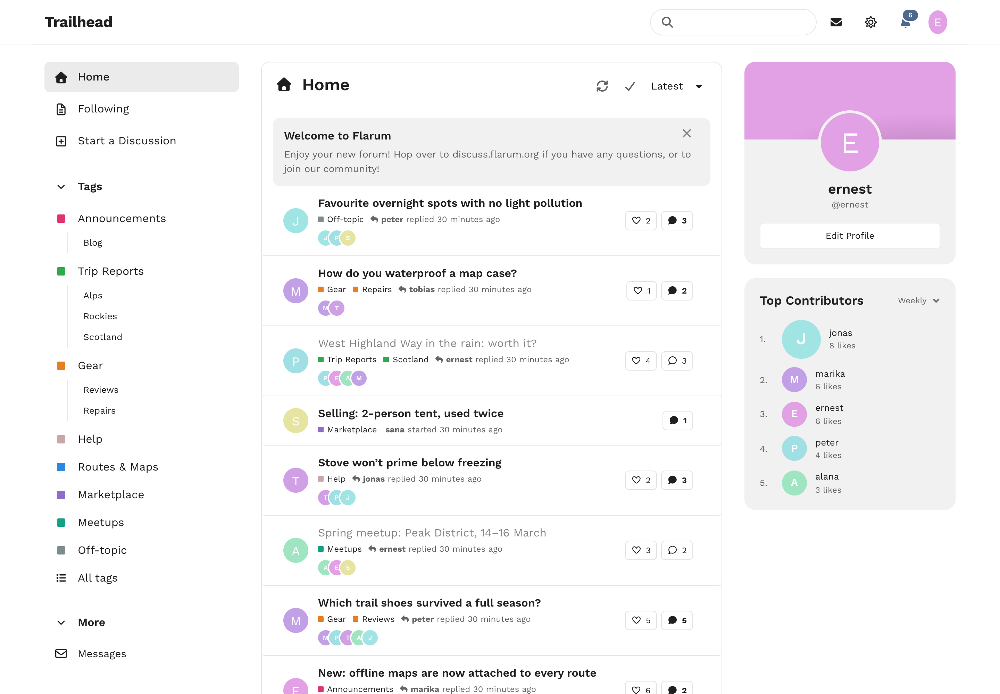
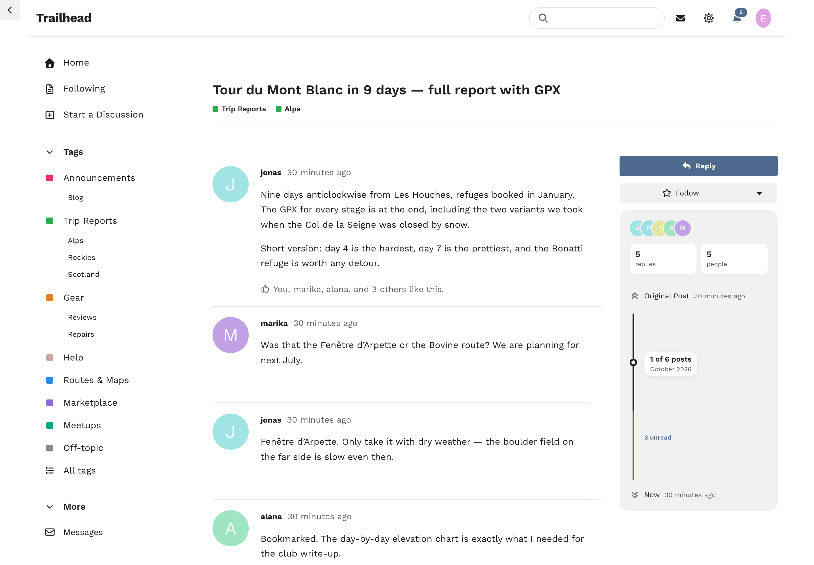
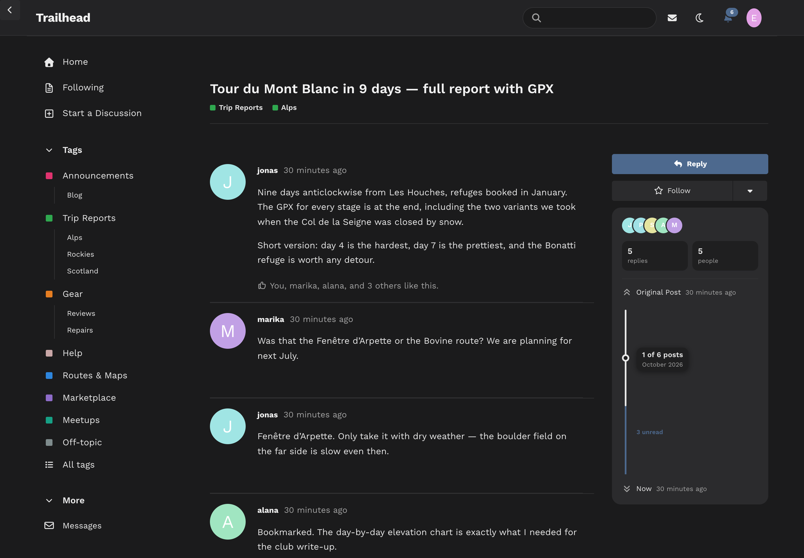
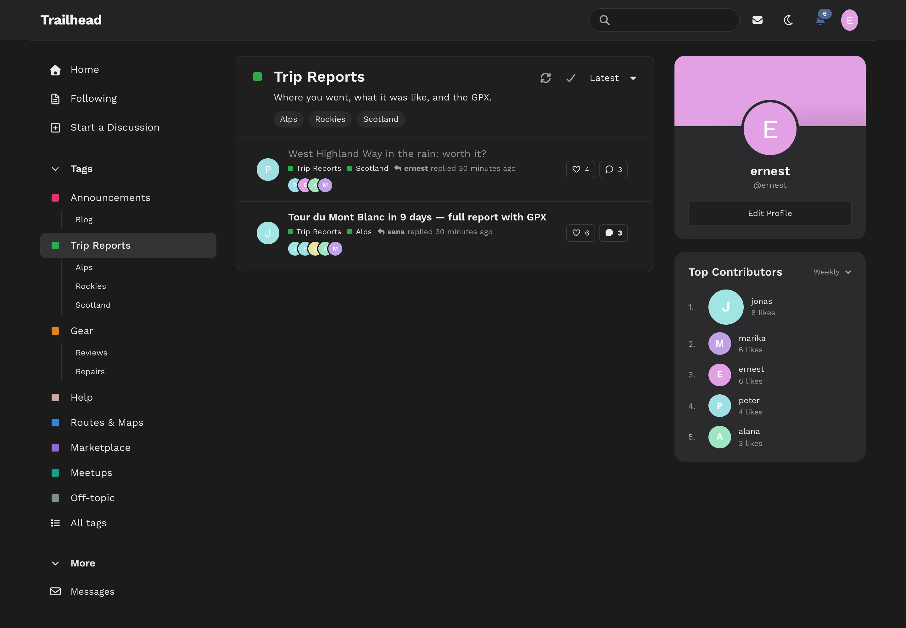
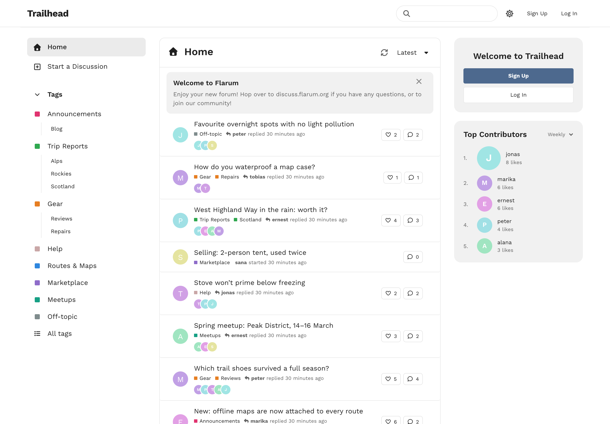
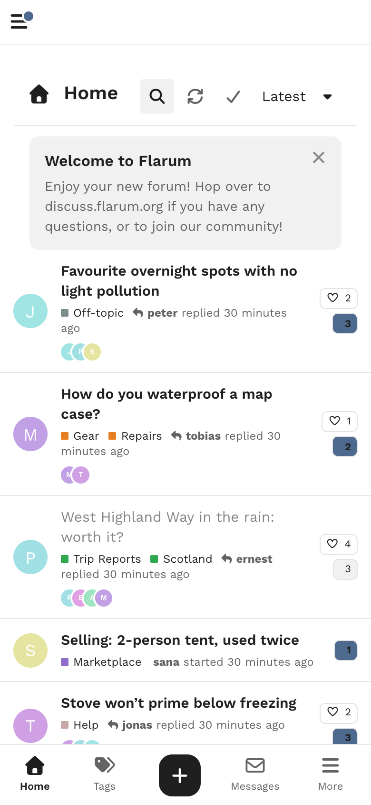
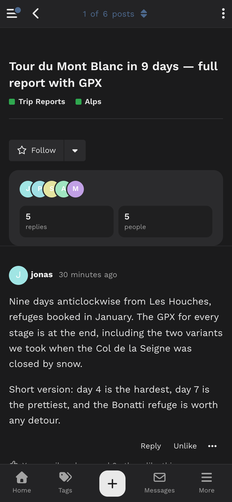
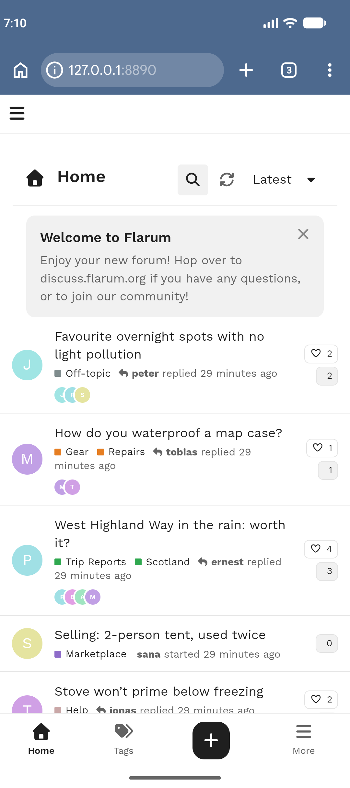
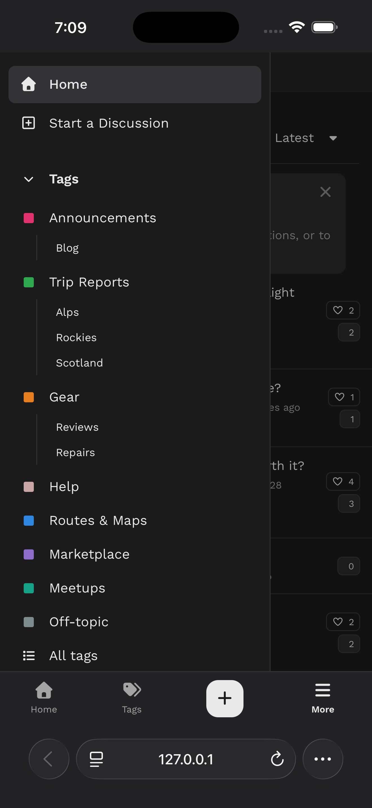

# Concourse

A clean three-column community theme for **Flarum 2**, recreating the look of *Central*, the Discourse theme Carson Chang and the Discourse team previewed on Meta and never shipped. There is a sidebar with your tag tree on every page, a card holding the discussion list, and a column on the right with your profile and the forum's Top Contributors.



## What it does

- **A clean header.** It holds the logo, a rounded search field, the Messages inbox (flarum/messages), notifications and your avatar.
- **A sidebar on every page.** It lists Home, Following (flarum/subscriptions), Admin for admins, and **Start a Discussion**. Under those is the **full tag tree**: each primary tag with its children hanging beneath on a hairline, in flarum/tags' own order, plus the busiest secondary tags. Every link other extensions add goes under **More**, so twenty extensions never push your tags off the screen. Your own **footer links** (About, Privacy, Terms…) sit at the bottom.
- **Unread dots** on tags with something new since your last visit. Read state is kept in the reader's own browser and costs no query.
- **One card for the list.** A title row says what you are looking at: Home, Following, a search, or a tag with its colour, description and child tags. The sort dropdown sits on the same row.
- **Compact rows** with the avatar, title, tags as small coloured squares and "who replied when". On the right is a **like** count for the opening post (flarum/likes) beside the reply count. Under the title are **the people taking part**: the author first, then whoever was active most recently, then "+N".
- **A right column** with:
  - **your profile card**: your cover ([Backdrop](https://github.com/ernestdefoe/backdrop), framed exactly as on your profile, or sycho/flarum-profile-cover; otherwise a band in your own colour), avatar, name, handle, bio (fof/user-bio) and **Edit Profile**. Guests see the forum's welcome with Sign up and Log in instead.
  - **Top Contributors**, switchable between **today, this week, this month and this year**. It ranks by likes received, or by comments on a forum without flarum/likes.
  - **any widget you add.** Both blocks are also offered as widgets for **Bespoke** and **FoF Forum Widgets**. FoF's side widgets stack in the same column.
- **Light and dark**, following Flarum's own colour scheme setting. Central's neutral greys sit underneath, the forum's primary colour is the accent, and the font is Work Sans.

### Discussions



The title, with its tags beneath, heads the page. Beside the posts are Reply, Follow, and one panel holding:
- the faces of the people taking part, and how many replies and people there are (and views, with fof/discussion-views)
- a **restyled scrubber**: a thick rail, the posts you have read in dark ink and the unread ones in the accent colour, a small card beside the handle ("4 of 57 · October 3"), and the date beside *Original Post* and *Now*.

| Dark | A tag, dark | As a guest |
|---|---|---|
|  |  |  |

### On phones

The sidebar becomes a drawer, opened from a tab bar along the bottom with Home, Tags, **+** (new discussion), Messages and More. Between phone and desktop the sidebar shrinks to a rail of icons and tag colours.

Tested on real devices: Mobile Safari on an iPhone 17 Pro Max simulator, and Chrome on a Pixel 9 emulator.

| Home | A discussion, dark | Android | iPhone: the drawer |
|---|---|---|---|
|  |  |  |  |

## Settings

*Admin → Concourse*

- **Show the profile card** and **Show Top Contributors**.
- **The period Top Contributors starts on** and **how many people** it lists (1–10).
- **Show who is taking part**: the faces under each discussion and in the side panel. Turning it off also drops their queries.
- **Sidebar footer links**, one per line as `Label | address`. Only pages on the forum (`/p/about`), `https://` links and `mailto:` are accepted.

## With Wardrobe

Concourse works as one of several themes under [ernestdefoe/wardrobe](https://github.com/ernestdefoe/wardrobe). A visitor on another theme gets none of its CSS, JS or server work: no child-tag query, no like counts, no participants, no font preload.

## Cost

Measured with the test suite (enforced there) and by timing a forum with 166,000 posts.

| | |
|---|---|
| Discussion list, 1 row or 50 | +3 queries for the whole page (opening-post likes, the participants, their accounts); flat with the row count |
| Participants | only each discussion's latest 30 posts are read, through the existing index. About 5 ms per page at 166k posts |
| Discussion page | +2 (the participants and their accounts) |
| Forum payload | +2 (child tags and their parents), flat with the number of tags |
| Top Contributors | one grouped query per period, cached for 5 minutes (today) to an hour (this year) and shared by everyone; 1 query per request once warm |
| forum.js | 6.2 KB gzipped |
| forum.css | +4.3 KB gzipped |

Top Contributors only counts what a **guest** could see: public discussions and visible, approved comments. A shared number never includes activity behind a restricted tag.

## Installation

```sh
composer require ernestdefoe/concourse
```

Then enable **Concourse** in your admin panel. To update:

```sh
composer update ernestdefoe/concourse
php flarum cache:clear
```

## Credits

The design is Central's, by Carson Chang and the Discourse team (MIT, © Civilized Discourse Construction Kit, Inc.). See [NOTICE](NOTICE). The code is written fresh for Flarum. Work Sans is by the Work Sans Project Authors (SIL OFL 1.1) and is self-hosted.

If Concourse is useful to you, you can [buy me a coffee](https://buymeacoffee.com/ernestdefoe).

## Licence

MIT
